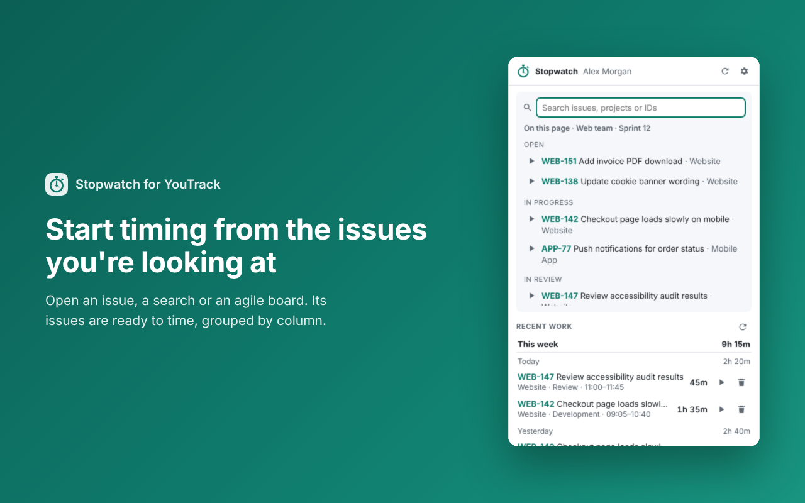

# Stopwatch for YouTrack

A Chrome extension that adds a one-click stopwatch to [YouTrack](https://www.jetbrains.com/youtrack/) time tracking.
Pick an issue, start the clock, stop it, and the time is logged as a YouTrack work item.
You paste your YouTrack token once; it is stored encrypted and never asked for again.

<p align="center"></p>

## Features

- **Issues from the page you're on**: single issue, issue list or search, saved search, tag, agile board (grouped by column).
- **Search while you type**: page issues, issues you recently worked on, and all of YouTrack (partial words and project names match: "somas" finds SOMASTREAM-297).
- **Timer**: start/stop, edit the start time, choose a work type, discard. The work item is dated when the timer started.
- **Works offline**: work items that can't be sent are kept and retried automatically.
- **Recent work**: grouped by week and day with totals; restart or delete entries.
- **Toolbar or in-page**: a toolbar popup in normal windows, and a floating button inside YouTrack when it runs as an app window (`chrome --app=…` or installed as an app), which has no toolbar.
- Several YouTrack accounts, light/dark theme, your choice of accent colour.

## Security

| | |
|---|---|
| Token at rest | AES-256-GCM, encrypted with a **non-exportable** WebCrypto key held in the extension's IndexedDB; the account id is bound into the ciphertext |
| Token in use | Only the background service worker decrypts or uses it. The popup, the in-page panel and the content script never see it |
| Network | Talks only to your YouTrack server, using a host permission requested for that server alone. "Allow all origins" (CORS) does **not** need to be enabled on YouTrack. Cookies are never sent; the token never follows redirects |
| Permissions | `storage`, `alarms`, `scripting`, plus your YouTrack site. No `tabs`, no access to other sites |
| Messaging | Every request to the background is checked: only the extension's own pages may act; the in-page script can only ask whether to show its button; a panel framed by any other site is refused |
| Build | No remote code, strict extension CSP, no source maps in releases |
| Sign-out | Deletes the token; removing the last account also deletes the key and the site permission |

**Limit:** like any extension that doesn't ask for a password, the key lives in your Chrome profile. Someone with full
access to your unlocked profile could use the extension as you. What it prevents is the token being readable as text
(storage dumps, backups, debugging tools, sync or export by other software).

See [PRIVACY.md](PRIVACY.md): no data goes anywhere except your own YouTrack server.

## Install

**From the Chrome Web Store:** _link coming after review._

**From source (unpacked):**

1. Download or clone this repository.
2. Open `chrome://extensions`, turn on **Developer mode**, click **Load unpacked**, choose the folder.
3. Click the toolbar button → **Open setup** → enter your YouTrack address and a
   [permanent token](https://www.jetbrains.com/help/youtrack/cloud/manage-permanent-token.html).

The `dist/` folder is prebuilt, so no npm step is needed.

## Development

```sh
npm install
npm run build       # bundle src/ → dist/ with esbuild
npm run watch       # rebuild on change (inline source maps, dev only)
npm run typecheck   # tsc --noEmit
npm run zip         # build + stopwatch-for-youtrack.zip for the Chrome Web Store
```

```
src/background/   service worker: vault.ts (crypto), youtrack.ts (API), page.ts (URL → issues), store.ts, index.ts (router)
src/content/      panel.ts – in-page launcher (closed shadow DOM + iframe)
src/ui/           React UI shared by popup.html and panel.html
src/shared/       types, message protocol, time helpers
store/            Chrome Web Store listing text and images
docs/             GitHub Pages site (privacy policy)
```

## Credits

Inspired by YouClock by friess.studio; this is an independent rewrite with its own code and design.
YouTrack is a trademark of JetBrains s.r.o. This project is not affiliated with or endorsed by JetBrains.

## License

[MIT](LICENSE)
